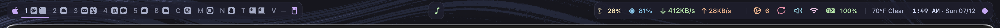
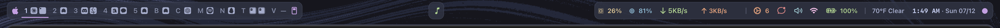
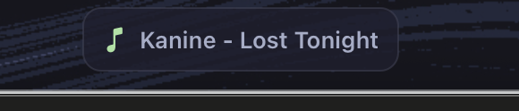

# SketchyBar Islands

A SketchyBar configuration built around three floating "islands" on a fully
transparent bar, themed with Catppuccin and driven by AeroSpace. Runs on the
2026 rebuild of the personal-Mac setup (5120x1440 ultrawide plus a notched
16" MacBook Pro).

## Showcase

Mocha, macchiato, and frappe on the notched MacBook display (workspaces with
per-app glyphs left, media at the notch, stats/widgets/clock right):





The media island expanded (hover or track change):

<p>
  
</p>

## Layout

- **Left island:** Apple menu trigger, AeroSpace workspaces with per-space app
  glyphs and a mauve underline on focus, in-bar menu items (toggle with the
  switch dot), and an `[service]`/`[resize]` binding-mode indicator.
- **Center island:** Spotify now-playing with hover-expand and popup controls.
  Sits at `center` on wide displays and at `q` (left of the notch) when only
  the built-in display is active.
- **Right island:** CPU, RAM, network up/down (pushed by `stats_provider`
  every 2s), disk popup, brew outdated count, Messages unread, VPN badge,
  volume with slider popup, Wi-Fi with IP popup, battery with percent,
  weather (Open-Meteo), clock, and the Catppuccin flavor cycler.

## Theme

Click the dot at the far right of the bar to cycle mocha, macchiato, and
frappe. The choice persists in the untracked `flavor` file; missing file
means mocha. Palettes live in `colors.lua` with real Catppuccin names.

## Requirements

- sketchybar (v2.24+) and the SbarLua module at
  `~/.local/share/sketchybar_lua/sketchybar.so`
- AeroSpace, with the workspace/mode triggers from this setup's
  `aerospace.toml` additions (every workspace/mode binding in
  `aerospace.toml` fires a `sketchybar --trigger` companion event)
- `stats_provider` from `joncrangle/tap/sketchybar-system-stats`
- SF Pro, SF Symbols, and `sketchybar-app-font`
- `SwitchAudioSource` (volume device popup), `jq` not required

## Reload

Never use `sketchybar --reload`:

```bash
launchctl kickstart -k gui/$(id -u)/homebrew.mxcl.sketchybar
```

## Process architecture (the load-bearing part)

sketchybar v2.24 SIGKILLs the config script's process group about 60 seconds
after launch. A resident SbarLua event loop looks like a hung script to that
watchdog, so it was reaped every boot, silently killing all event handling.
The entrypoint chain defeats it:

```
sketchybarrc          kills the previous generation, spawns detached, exits
  -> rc-runner.sh     new session (setsid), segfault retry, lifecycle log
     -> lua rc.lua    the actual SbarLua config
```

Lifecycle log: `/tmp/rc_trace.log`. The other hard-won SbarLua-on-v2.24
gotchas (graph add segfault, exec JSON table results, `updates = true` on
self-hiding items, and more) are listed below.

## SbarLua on v2.24 gotchas

1. Never `sbar.add("graph", ...)`. It segfaults the module on sketchybar
   v2.24, which is why the CPU widget is a plain percent label. If a graph is
   needed, create it via the CLI (`sketchybar --add graph ...`) and push
   values with the CLI from the event handler.
2. Never call `sbar.delay()` at config top level, before the event loop
   starts. It segfaults. Inside event handlers it is fine.
3. Any item that sets `drawing = false` on itself must also set
   `updates = true`. Otherwise the default `when_shown` means its event
   handlers never fire while it is hidden, so it can never wake back up (mode,
   vpn, brew).
4. `sbar.exec` JSON-parses command output: a callback receives a Lua table
   when the output is valid JSON and a string otherwise. Handle both.
5. Do not pass an empty `{}` config table to `sbar.add`. It serializes as a
   dangling `--set` that swallows the next batched command.
6. Custom events must be registered with `sbar.add("event", ...)` before any
   item subscribes; a provider that registers the event later is too late.
7. Bracket regex membership is evaluated only at creation time, so islands
   that contain async-created items (spaces, media) are rebuilt afterward
   (see `spaces.lua` / `media.lua`).
8. Boot `stats_provider` with a delay from `stats.lua`. Starting it while the
   bar is still processing its config kills it.
9. `sbar.exec` children inherit `SIGCHLD = SIG_IGN`, which breaks any child
   that does its own process bookkeeping. Brew's Ruby dies with "undefined
   method 'success?' for nil" before printing anything, and a trailing
   `| wc -l` masks it as a clean 0. Neither python's `restore_signals` nor
   bash `trap - CHLD` undoes an inherited ignore; the fix is an explicit
   `signal.signal(SIGCHLD, SIG_DFL)` in a python wrapper before spawning the
   tool (see `brew.lua`).
