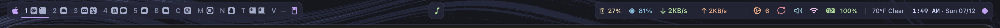

# SketchyBar Islands

A Catppuccin-themed [SketchyBar](https://github.com/FelixKratz/SketchyBar) setup that draws three floating "islands" on a fully transparent bar: AeroSpace workspaces on the left, Spotify now playing in the center, and system widgets on the right. Written in Lua on SbarLua, with a process architecture that survives SketchyBar v2.24's config watchdog and a documented list of hard-won SbarLua gotchas.

## Showcase

Mocha, macchiato, and frappe on a notched MacBook display (workspaces with per-app glyphs left, media at the notch, stats/widgets/clock right):





The media island expanded (hover or track change):

<p>
  
</p>

## Features

- Three floating islands on a transparent bar, styled as rounded translucent cards
- Catppuccin theming: click the dot at the far right to cycle mocha, macchiato, and frappe; the choice persists across restarts
- AeroSpace workspaces with per-workspace app glyphs and an accent underline on the focused workspace
- In-bar menu titles for the frontmost app, toggled with the switch dot
- AeroSpace binding-mode indicator (shows `[service]`, `[resize]`, and so on while a non-main mode is active)
- Spotify now playing with hover-expand and a popup with previous, play/pause, and next controls
- CPU, RAM, and network up/down speeds pushed by an event-driven stats provider every 2 seconds, with a disk free/used popup; the provider is respawned automatically if it dies across sleep/wake
- Homebrew outdated count (hidden at zero, red at 10 or more) with a popup listing the packages
- Messages unread badge
- VPN indicator (detects an active `utun` interface)
- Volume icon with a slider popup and an output device picker, scroll to adjust, right-click to open Sound settings
- Wi-Fi status with an IP, subnet mask, and router popup; click a row to copy it
- Battery percentage with a time-remaining popup
- Weather from Open-Meteo (temperature and condition, refreshed hourly)
- Clock and date; click to open Calendar
- Display-aware layout: the media island sits at `center` on wide displays and at `q` (left of the notch) when only the built-in display is active, and the bar reloads itself when the display setup changes

## Requirements

- macOS with Homebrew on Apple Silicon (paths like `/opt/homebrew` are hardcoded)
- Xcode Command Line Tools (the config compiles small C helpers at load time)
- [SketchyBar](https://github.com/FelixKratz/SketchyBar) v2.24 or later
- [SbarLua](https://github.com/FelixKratz/SbarLua) installed at `~/.local/share/sketchybar_lua/sketchybar.so`
- Lua from Homebrew (`/opt/homebrew/bin/lua`); the interpreter major version must match the Lua vendored into your SbarLua build (current SbarLua HEAD vendors 5.5)
- [AeroSpace](https://github.com/nikitabobko/AeroSpace) with the trigger additions shown below
- `stats_provider` from [joncrangle/sketchybar-system-stats](https://github.com/joncrangle/sketchybar-system-stats)
- `SwitchAudioSource` from `switchaudio-osx` (output device popup)
- Fonts: SF Pro, SF Mono, SF Symbols, Symbols Nerd Font, and [sketchybar-app-font](https://github.com/kvndrsslr/sketchybar-app-font) (both the regular and the `-bg` variant; the workspace glyphs use `sketchybar-app-font-bg`)

## Install

1. Install the core packages:

   ```bash
   xcode-select --install

   brew install lua switchaudio-osx
   brew tap FelixKratz/formulae
   brew install sketchybar
   brew install joncrangle/tap/sketchybar-system-stats
   brew install --cask nikitabobko/tap/aerospace
   ```

2. Install the fonts:

   ```bash
   brew install --cask sf-symbols font-sf-pro font-sf-mono font-symbols-only-nerd-font

   curl -L https://github.com/kvndrsslr/sketchybar-app-font/releases/latest/download/sketchybar-app-font.ttf \
     -o "$HOME/Library/Fonts/sketchybar-app-font.ttf"
   curl -L https://github.com/kvndrsslr/sketchybar-app-font/releases/latest/download/sketchybar-app-font-bg.ttf \
     -o "$HOME/Library/Fonts/sketchybar-app-font-bg.ttf"
   ```

3. Build and install the SbarLua module:

   ```bash
   git clone https://github.com/FelixKratz/SbarLua.git /tmp/SbarLua
   cd /tmp/SbarLua && make install && rm -rf /tmp/SbarLua
   ```

4. Clone this repo as your SketchyBar config:

   ```bash
   git clone https://github.com/walshg3/sketchybar-islands.git ~/.config/sketchybar
   ```

5. Add the SketchyBar triggers to `~/.config/aerospace/aerospace.toml`. The workspace, focus, and mode items are driven entirely by these events:

   ```toml
   # Start sketchybar together with AeroSpace
   after-startup-command = ['exec-and-forget sketchybar']

   # Forward workspace changes to the bar
   exec-on-workspace-change = ['/bin/bash', '-c',
     'sketchybar --trigger aerospace_workspace_change FOCUSED_WORKSPACE=$AEROSPACE_FOCUSED_WORKSPACE'
   ]

   # Keep the per-workspace app glyphs current
   on-focus-changed = ['exec-and-forget sketchybar --trigger aerospace_focus_change']
   ```

   For the binding-mode indicator, every binding that enters or leaves a mode needs a companion trigger, for example:

   ```toml
   [mode.main.binding]
   alt-shift-semicolon = ['exec-and-forget sketchybar --trigger aerospace_mode_change MODE=service', 'mode service']

   [mode.service.binding]
   esc = ['exec-and-forget sketchybar --trigger aerospace_mode_change MODE=main', 'mode main']
   ```

6. Start the bar:

   ```bash
   brew services start sketchybar
   ```

7. Optional: grant Full Disk Access to `sketchybar` (System Settings, Privacy & Security, Full Disk Access) so the Messages unread badge can read the Messages database. Without it the badge simply stays hidden.

The `helpers/menus/bin/menus` helper binary is compiled automatically the first time the config loads.

## Layout

- **Left island:** Apple menu trigger, AeroSpace workspaces with per-space app glyphs and an underline on focus, in-bar menu items (toggle with the switch dot), and a `[service]`/`[resize]` binding-mode indicator.
- **Center island:** Spotify now playing with hover-expand and popup controls. Sits at `center` on wide displays and at `q` (left of the notch) when only the built-in display is active.
- **Right island:** CPU, RAM, network up/down (pushed by `stats_provider` every 2s), disk popup, brew outdated count, Messages unread, VPN badge, volume with slider popup, Wi-Fi with IP popup, battery with percent, weather (Open-Meteo), clock, and the Catppuccin flavor cycler.

## Theme

Click the dot at the far right of the bar to cycle mocha, macchiato, and frappe. The choice persists in the untracked `flavor` file; a missing file means mocha. Palettes live in `colors.lua` with real Catppuccin names, and every item pulls its colors from the semantic sections defined there.

## Customization

Each item is one file, so most changes are local edits:

- `colors.lua`: the three Catppuccin palettes and the semantic color sections every widget reads from
- `settings.lua` and `helpers/default_font.lua`: fonts and paddings
- `items/` and `items/widgets/`: one file per bar item; delete a `require` line from `items/init.lua` or `items/widgets/init.lua` to drop a widget
- `items/widgets/stats.lua`: the network interface is hardcoded to `en0`; change the `--network en0` provider argument if your primary interface differs
- `items/widgets/weather.lua`: temperature is hardcoded to Fahrenheit; edit the Open-Meteo URL to switch units
- `bar.lua`: `notch_width = 230` widens the notch dead zone for a 16 inch MacBook Pro; adjust for other notched displays
- `helpers/icon_map.lua`: app name to glyph mapping for the workspace icons. A few entries (`:dia:`, `:hermes:`, `:t3_code_nightly:`) reference glyphs that only exist in a locally patched copy of sketchybar-app-font; the SVG sources live in `custom-icons/`. With the stock font those apps render as a missing glyph, so remove or remap those entries if you do not patch the font. Unknown apps fall back to the `default` glyph.

## Privacy and permissions notes

- The weather widget fetches your approximate location once from `ipinfo.io/loc` (cached in `/tmp/sketchybar_loc`) and then queries `api.open-meteo.com`. Delete the cache file to refresh the location, or remove the widget to avoid the network calls entirely.
- The Messages badge runs a read-only SQLite query against `~/Library/Messages/chat.db`, which requires Full Disk Access for the SketchyBar process.

## Reload

Never use `sketchybar --reload` with this config. Config re-execution after a reload segfaults the SbarLua module on this SketchyBar version; a fresh daemon boot is reliable:

```bash
launchctl kickstart -k gui/$(id -u)/homebrew.mxcl.sketchybar
```

## Process architecture (the load-bearing part)

sketchybar v2.24 SIGKILLs the config script's process group about 60 seconds after launch. A resident SbarLua event loop looks like a hung script to that watchdog, so it was reaped every boot, silently killing all event handling. The entrypoint chain defeats it:

```
sketchybarrc          kills the previous generation, spawns detached, exits
  -> rc-runner.sh     new session (setsid), segfault retry, lifecycle log
     -> lua rc.lua    the actual SbarLua config
```

Lifecycle log: `/tmp/rc_trace.log` (runner output goes to `/tmp/rc_runner.log`). The other hard-won SbarLua-on-v2.24 gotchas (graph add segfault, exec JSON table results, `updates = true` on self-hiding items, and more) are listed below.

## SbarLua on v2.24 gotchas

1. Never `sbar.add("graph", ...)`. It segfaults the module on sketchybar
   v2.24, which is why the CPU widget is a plain percent label. If a graph is
   needed, create it via the CLI (`sketchybar --add graph ...`) and push
   values with the CLI from the event handler.
2. Never call `sbar.delay()` at config top level, before the event loop
   starts. It segfaults. Inside event handlers it is fine.
3. Any item that sets `drawing = false` on itself must also set
   `updates = true`. Otherwise the default `when_shown` means its event
   handlers never fire while it is hidden, so it can never wake back up (mode,
   vpn, brew).
4. `sbar.exec` JSON-parses command output: a callback receives a Lua table
   when the output is valid JSON and a string otherwise. Handle both.
5. Do not pass an empty `{}` config table to `sbar.add`. It serializes as a
   dangling `--set` that swallows the next batched command.
6. Custom events must be registered with `sbar.add("event", ...)` before any
   item subscribes; a provider that registers the event later is too late.
7. Bracket regex membership is evaluated only at creation time, so islands
   that contain async-created items (spaces, media) are rebuilt afterward
   (see `spaces.lua` / `media.lua`).
8. Boot `stats_provider` with a delay from `stats.lua`. Starting it while the
   bar is still processing its config kills it.
9. `sbar.exec` children inherit `SIGCHLD = SIG_IGN`, which breaks any child
   that does its own process bookkeeping. Brew's Ruby dies with "undefined
   method 'success?' for nil" before printing anything, and a trailing
   `| wc -l` masks it as a clean 0. Neither python's `restore_signals` nor
   bash `trap - CHLD` undoes an inherited ignore; the fix is an explicit
   `signal.signal(SIGCHLD, SIG_DFL)` in a python wrapper before spawning the
   tool (see `brew.lua`).

## Repo layout

```
sketchybarrc          entrypoint invoked by the sketchybar daemon
rc-runner.sh          detached runner (new session, segfault retry)
rc.lua                loads helpers and the SbarLua config
init.lua              bar, defaults, display detection, items, event loop
bar.lua               transparent bar and notch dead zone
colors.lua            Catppuccin palettes and semantic color sections
default.lua           item defaults (fonts, paddings, popup style)
settings.lua          font and icon-set selection
icons.lua             SF Symbols and Nerd Font glyphs
items/                one file per bar item
items/widgets/        right-island widgets
helpers/              islands (brackets), display detection, icon map,
                      compiled C helper (menus)
custom-icons/         SVG sources for locally patched app-font glyphs
```

## Credits

- [SketchyBar](https://github.com/FelixKratz/SketchyBar) and [SbarLua](https://github.com/FelixKratz/SbarLua), the bar and its Lua runtime
- [Catppuccin](https://github.com/catppuccin/catppuccin) for the palettes
- [joncrangle/sketchybar-system-stats](https://github.com/joncrangle/sketchybar-system-stats) for the event-driven stats provider
- [kvndrsslr/sketchybar-app-font](https://github.com/kvndrsslr/sketchybar-app-font) for the app glyph font
- [crissNb/Dynamic-Island-Sketchybar](https://github.com/crissNb/Dynamic-Island-Sketchybar) for the dynamic island inspiration

## License

[MIT](LICENSE).
